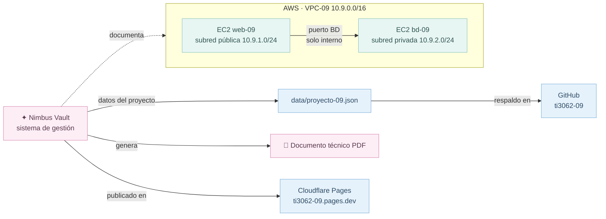

<div align="center">

<sub>⋆｡‧˚ʚ ☁ ɞ˚‧｡⋆</sub>

# ✦ Nimbus Vault ✦

**Consola de planificación, seguridad y gobierno de infraestructura cloud**

<sub>☁ app web pública &nbsp;✦&nbsp; base de datos aislada &nbsp;✦&nbsp; acceso con MFA</sub>

<br>


<br>


</div>

**Nimbus Vault** es el sistema web de gestión del proyecto integrador de la **Evaluación 4 de TI3062**. Reemplaza al informe tradicional: en él se registran la problemática, los requerimientos, la comparativa cloud, los controles NIST, la bitácora de implementación y las pruebas, y con esos datos se **genera automáticamente el documento técnico en PDF**.

<br>

| | |
|---|---|
| **Autora** | Taís Cruz · N° de lista **09** |
| **Asignatura** | TI3062 · Gestión de Seguridad de la Información · INACAP |
| **Sistema publicado** | *pendiente* |
| **Repositorio** | https://github.com/iboooop/ti3062-09 |

<sub>Estados: ✅ hecho &nbsp;·&nbsp; 🛠️ en progreso &nbsp;·&nbsp; 🕓 pendiente</sub>

---

## ✦ Contenido

1. [Cómo funciona](#-cómo-funciona)
2. [Avance del sistema de gestión](#-avance-del-sistema-de-gestión)
3. [Infraestructura en AWS](#-infraestructura-en-aws)
4. [Endurecimiento de sistemas operativos](#-endurecimiento-de-sistemas-operativos)
5. [Pruebas de validación](#-pruebas-de-validación)
6. [Cómo usar el sistema](#-cómo-usar-el-sistema)
7. [Estructura del repositorio](#-estructura-del-repositorio)
8. [Seguridad y uso responsable](#-seguridad-y-uso-responsable)
9. [Créditos](#-créditos)

---

## ☁ Cómo funciona



1. **Registro:** en el sistema se registran el plan de trabajo, los requerimientos, los controles, la bitácora y las pruebas.
2. **Persistencia:** los datos se guardan en el navegador y se pueden exportar e importar como `data/proyecto-09.json`.
3. **Documento:** el botón **Generar PDF** construye el documento técnico a partir de los datos actuales.
4. **Infraestructura:** la aplicación del caso se despliega en AWS, y cada configuración queda registrada con evidencia en la bitácora.

---

## ✧ Avance del sistema de gestión

| Módulo / requisito | Estado |
|---|---|
| Interfaz, navegación por módulos y diseño | ✅ |
| Temas de color (playa, brisa, nube, agua, musgo, caramelo) | ✅ |
| Panel de estado con indicadores que cambian según la situación | ✅ |
| Panel de resumen con indicadores calculados desde los datos | 🛠️ diseño listo, falta conectarlo a los datos |
| Plan de trabajo: ≥ 3 hitos y ≥ 10 tareas con responsable, fechas, dependencia y estado | 🛠️ diseño listo |
| Contexto: actores, procesos, ≥ 4 RF y ≥ 4 RNF | 🛠️ diseño listo |
| Comparativa cloud: AWS y otro proveedor, con costos de la calculadora oficial | 🛠️ diseño listo |
| Controles NIST SP 800-53 Rev. 5 (≥ 3) | 🛠️ diseño listo |
| Bitácora de implementación con evidencias | 🛠️ diseño listo |
| Validación y cierre: pruebas, hallazgos, análisis CIA, riesgos y mejoras | 🛠️ diseño listo |
| Guardado en el navegador (localStorage) | 🕓 |
| Exportar / importar JSON (`data/proyecto-09.json`) | 🕓 |
| Generación del PDF desde los datos | 🕓 |
| Publicación en Cloudflare Pages | 🕓 |
| ≥ 15 commits en ≥ 3 días distintos | 🛠️ |

---

## ☁ Infraestructura en AWS

| Recurso | Valor | Estado |
|---|---|---|
| VPC | `VPC-09` · `10.9.0.0/16` | 🕓 |
| Subred pública | `10.9.1.0/24` · ruta `0.0.0.0/0` → `IGW-09` | 🕓 |
| Subred privada | `10.9.2.0/24` · solo ruta local, sin IP pública automática | 🕓 |
| Internet Gateway | `IGW-09` | 🕓 |
| Instancia web | `web-09` · Ubuntu Server · subred pública | 🕓 |
| Instancia base de datos | `bd-09` · Ubuntu Server · subred privada | 🕓 |
| `sg-web-09` | 80/443 desde `0.0.0.0/0` · 22 solo desde mi IP | 🕓 |
| `sg-bd-09` | puerto del motor solo desde `sg-web-09` · 22 solo desde web-09 | 🕓 |
| Firewall de host (UFW/nftables) | en ambas instancias, coherente con los SG | 🕓 |
| Aplicación del caso | formulario + listado con ≥ 2 tablas relacionadas | 🕓 |
| Usuario de BD exclusivo | privilegios solo sobre `ti3062_09`, sin `ALL` ni `'%'` | 🕓 |
| Respaldo automático | cron diario en `/respaldos` (volumen cifrado) | 🕓 |
| Restauración probada | con evidencia | 🕓 |
| Snapshots | volúmenes de ambas instancias | 🕓 |

---

## ⊹ Endurecimiento de sistemas operativos

| Control | Detalle | Estado |
|---|---|---|
| Identidades | 3 grupos (administración, desarrollo, auditoría), máx. 3 usuarios por instancia con sufijo 09 | 🕓 |
| sudoers | reglas en `/etc/sudoers.d/` con comandos específicos | 🕓 |
| SSH | `PermitRootLogin no`, `PasswordAuthentication no`, `MaxAuthTries 3`, `AllowGroups`, llaves ED25519 | 🕓 |
| MFA | TOTP obligatorio para el grupo administrador | 🕓 |
| Cifrado en reposo | volumen LUKS montado en `/respaldos` | 🕓 |
| Auditoría | `auditd` sobre sudo, `/etc/passwd`, `/etc/sudoers`, `sshd_config` y accesos SSH | 🕓 |

---

## ✧ Pruebas de validación

| ID | Prueba | Resultado esperado | Estado |
|---|---|---|---|
| P1 | Acceso a la aplicación desde Internet (80/443) | Aplicación operativa, inserta y lista datos | 🕓 |
| P2 | Escaneo `nmap` a bd-09 desde el exterior | Sin acceso; sin IP pública | 🕓 |
| P3 | Conexión web → BD con el usuario de la aplicación | Conexión exitosa solo desde web-09 | 🕓 |
| P4 | Salida a Internet desde bd-09 (`ping`/`curl`) | Falla | 🕓 |
| P5 | SSH con contraseña o como root | Rechazado | 🕓 |
| P6 | SSH administrativo sin código TOTP | Rechazado | 🕓 |
| P7 | Comando no autorizado en sudoers | Denegado y registrado en auditd | 🕓 |
| P8 | Lectura del volumen LUKS cerrado | Datos ilegibles | 🕓 |

---

## ✦ Cómo usar el sistema

1. Abre `index.html` en el navegador, o entra a la URL publicada.
2. Navega por los módulos con el menú: Inicio, Plan de trabajo, Contexto, Proveedores, Controles, Bitácora, Pruebas e Informe.
3. Cambia el aspecto en el panel **temas**.
4. Usa **exportar JSON** para respaldar el proyecto e **importar JSON** para restaurarlo. 🕓
5. En **Informe**, presiona **Generar PDF** para crear el documento técnico. 🕓

---

## ⋆ Estructura del repositorio

```
ti3062-09/
├── index.html          → página principal
├── README.md
├── css/
│   ├── aero.css        → estilos
│   ├── temas.css       → paletas de color intercambiables
│   └── fuentes.css     → fuentes alojadas localmente
├── js/
│   └── ui.js           → pestañas, temas, panel de estado y efectos
├── fonts/              → fuentes con licencia SIL OFL
├── img/estado/         → indicadores de estado
├── cursores/           → cursor personalizado
├── data/               → proyecto-09.json 🕓
└── docs/               → capturas para este README
```

---

## ♡ Seguridad y uso responsable

- El repositorio **no contiene** llaves privadas, contraseñas ni credenciales de la base de datos.
- Las credenciales de la aplicación del caso se guardan fuera del código publicado.
- Las fuentes se alojan en el propio sitio: la página no depende de servicios de terceros ni comparte datos de quien la visita con ellos.
- Los datos que se ven actualmente en los módulos son de ejemplo y se reemplazarán por los del proyecto real.

---

## ✧ Créditos

- Pauta de la Evaluación 4 y guías de la asignatura TI3062.
- Fuentes **Mystery Quest**, **Henny Penny**, **DotGothic16**, **VT323** y **Nunito**, bajo licencia SIL Open Font License.
- Íconos de estado, avatar y decoraciones dibujados en SVG para este proyecto.
- Aros indicadores de estado: *https://neo-himeism.net/free-web-elements/icon-and-button/p_circle001*

<div align="center">

<br>

<sub>𓏲 ๋࣭ ࣪ ˖ ✦ Proyecto Integrador de Seguridad en Infraestructura Cloud y Redes ✦ ˖ ࣪ ๋࣭ 𓏲</sub>

</div>
